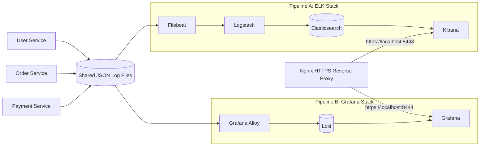

<div align="center">

# Centralized Logging Pipeline

**Structured, correlated logs from three Node.js microservices, collected through two independent observability stacks: ELK and Grafana Loki.**


</div>

---

## Table of Contents

1. [Project Overview](#project-overview)
2. [Architecture](#architecture)
3. [Technology Stack](#technology-stack)
4. [Features](#features)
5. [Repository Structure](#repository-structure)
6. [Data Flow Details](#data-flow-details)
7. [Request Correlation](#request-correlation)
8. [Security and Reliability](#security-and-reliability)
9. [Index Lifecycle Management](#index-lifecycle-management)
10. [Grafana Dashboard and Alerting](#grafana-dashboard-and-alerting)
11. [Prerequisites and Setup](#prerequisites-and-setup)
12. [TLS Certificate Setup](#tls-certificate-setup)
13. [Starting the Project](#starting-the-project)
14. [Application Endpoints](#application-endpoints)
15. [Testing](#testing)
16. [Acceptance Test Report](#acceptance-test-report)
17. [Troubleshooting](#troubleshooting)
18. [Persistence and Shutdown](#persistence-and-shutdown)
19. [Future Improvements](#future-improvements)
20. [Author](#author)

---

## Project Overview

In a microservice system, a single user action often touches several services, and each service writes its own logs. Without a central place to collect them, debugging means logging into multiple containers, guessing at timestamps, and manually stitching events together.

**Centralized logging** solves this by collecting logs from every service into searchable backends, in one consistent format, with identifiers that tie related events together.

This project implements centralized logging for three Node.js microservices:

- **User Service**
- **Order Service**
- **Payment Service**

Each service writes structured JSON logs (Pino and pino-http) to shared log files. Every request carries an `X-Request-ID`, which the Order Service forwards to the User Service, so one request can be followed across services.

### Why two independent pipelines?

The same logs feed two separate stacks:

| Pipeline | Stack | Purpose |
|---|---|---|
| **A** | Filebeat, Logstash, Elasticsearch, Kibana | Full-text search and indexed exploration |
| **B** | Grafana Alloy, Loki, Grafana | Label-based log streams, dashboards, and alerting |

Running both side by side makes it possible to compare how each stack ingests, stores, and queries the same data. It is also a practical way to learn the trade-offs between them.

### Engineering problems addressed

- Correlating events across services with a propagated request ID
- Keeping sensitive fields out of logs
- Avoiding high-cardinality labels in Loki
- Rolling over Elasticsearch indices through ILM
- Serving dashboards over HTTPS locally
- Verifying the whole pipeline with an automated end-to-end test

---

## Architecture



### Component responsibilities

| Component | Responsibility |
|---|---|
| **User, Order, Payment Services** | Handle requests and write structured JSON logs with request IDs |
| **Shared JSON log files** | Common hand-off point read by both pipelines |
| **Filebeat** | Tails the JSON log files and ships events to Logstash |
| **Logstash** | Parses timestamps, enriches events, and writes to Elasticsearch |
| **Elasticsearch** | Indexes and stores logs (internal to the Docker network) |
| **Kibana** | Search and exploration UI for Elasticsearch |
| **Grafana Alloy** | Discovers log files, parses JSON, assigns labels and structured metadata, pushes to Loki |
| **Loki** | Stores log streams indexed by labels |
| **Grafana** | Dashboards and alerting over Loki |
| **Nginx** | HTTPS reverse proxy in front of Kibana and Grafana |

---

## Technology Stack

| Technology | Purpose | Role in the Project |
|---|---|---|
| Node.js | Application runtime | Runs the three microservices |
| Pino / pino-http | Structured logging | JSON logs, request logging, field redaction |
| Docker Compose | Orchestration | Runs the full stack with one command |
| Filebeat | Log shipper | Tails JSON log files for the ELK pipeline |
| Logstash | Log processing | Timestamp parsing and enrichment |
| Elasticsearch | Search and storage | Indexes logs, alias-based writes, ILM |
| Kibana | Visualization | Search and exploration of indexed logs |
| Grafana Alloy | Log collector | Discovers, parses, and labels logs for Loki |
| Loki | Log storage | Stores label-indexed log streams |
| Grafana | Visualization and alerting | Dashboard and alert rule |
| Nginx | Reverse proxy | TLS termination for Kibana and Grafana |
| OpenSSL | Certificate tooling | Generates the local self-signed certificate |
| Bash | Testing | End-to-end integration test script |

---

## Features

- **Centralized structured logging** across all three services
- **JSON logging** with Pino and pino-http
- **Request ID generation and propagation** (`X-Request-ID`)
- **Cross-service request correlation** (Order Service forwards the ID to User Service)
- **Sensitive field redaction** for configured fields
- **Query-string removal** from logged request URLs
- **Dual logging pipelines** (ELK and Grafana/Loki) fed from the same log files
- **Elasticsearch indexing with alias-based writes** (`app-logs-write`)
- **ILM-based index rollover** (7 days or 5 GB)
- **Loki structured metadata** for request IDs and the correlation `traceId` field (currently mirroring `requestId`)
- **Grafana dashboard**: Centralized Application Logs
- **Grafana alerting**: ApplicationErrorLogs
- **Nginx HTTPS reverse proxy** for Kibana and Grafana
- **Docker Compose orchestration** with persistent named volumes
- **End-to-end integration tests** (`tests/integration.sh`)

> Features not listed above are not implemented. See [Future Improvements](#future-improvements).

---

## Repository Structure

```text
.
├── docker-compose.yml
├── .env.example
├── README.md
├── docs/
│   └── architecture.md
├── elk/
│   ├── elasticsearch/app-logs-template.json
│   ├── filebeat/filebeat.yml
│   └── logstash/pipeline/logstash.conf
├── grafana-stack/
│   ├── alloy/config.alloy
│   ├── grafana/dashboards/application-logs.json
│   └── loki/loki-config.yml
├── security/nginx/default.conf
├── services/
│   ├── order-service/
│   ├── payment-service/
│   └── user-service/
└── tests/integration.sh
```

Runtime files such as `.env`, TLS certificates and keys, application logs, backups, and `node_modules` are excluded from this published tree.
---

## Data Flow Details

### Pipeline A: ELK

1. The services produce JSON logs.
2. **Filebeat** tails the JSON log files.
3. **Logstash** parses timestamps and enriches events.
4. **Elasticsearch** indexes the logs.
5. **Kibana** provides search and exploration.

### Pipeline B: Grafana Stack

1. **Alloy** discovers the application log files.
2. Alloy parses the JSON.
3. Service and severity become **labels**.
4. Request IDs and the current correlation `traceId` field become **structured metadata**.
5. **Loki** stores the log streams.
6. **Grafana** visualizes logs and evaluates alerts.

### Why request IDs are structured metadata, not Loki labels

Loki indexes **labels** and creates a separate stream for each unique label combination. A request ID is unique per request, so using it as a label would create a huge number of streams. This is the high-cardinality problem, and it degrades ingestion and query performance.

**Structured metadata** attaches the value to each log entry without turning it into an index label. The request ID and correlation `traceId` field stay searchable, and the label set stays small and stable (service, severity, job). Currently, `traceId` mirrors `requestId`; it is not a separately generated distributed-tracing trace ID.

---

## Request Correlation

1. **Incoming `X-Request-ID`**: if the client sends a valid `X-Request-ID`, the service uses it.
2. **Generation**: if none is provided or it is not valid, the service generates a UUID.
3. **Response header**: the ID is returned to the client in the `X-Request-ID` response header.
4. **Forwarding**: the Order Service forwards the request ID to the User Service, so both services log the same ID.
5. **Investigation**: search that ID in Kibana (ELK) and in Grafana (Loki) to see the full path of the request across services and across both backends.

### Example

First, retrieve the users and copy an existing user ID from the response:

```bash
curl http://localhost:3102/users
```

Then create an order using that existing user ID:

```bash
REQUEST_ID=$(cat /proc/sys/kernel/random/uuid)

curl -i -X POST http://localhost:3103/orders \
  -H "Content-Type: application/json" \
  -H "X-Request-ID: ${REQUEST_ID}" \
  -d '{"userId":"EXISTING_USER_ID","product":"Keyboard","amount":99.99}'
```

Replace `EXISTING_USER_ID` with an ID returned by `GET /users`. The response should include the same `X-Request-ID` header.

Confirm that the response contains the same `X-Request-ID`, then search for that value in Kibana (`https://localhost:8443`) and Grafana (`https://localhost:8444`) using your request ID field name.

---

## Security and Reliability

| Area | Implementation |
|---|---|
| **Redaction** | Pino redacts the configured sensitive fields |
| **URL sanitization** | Query strings are removed from logged request URLs |
| **TLS** | Nginx serves Kibana and Grafana over HTTPS |
| **Host port binding** | Published ports bind to `127.0.0.1` only |
| **Elasticsearch exposure** | Not published on a host port; reachable only inside the Docker network |
| **Secrets** | Stored in `.env`, which must not be committed |
| **Private key** | Permissions set to `600` and excluded from Git |
| **Persistence** | Named Docker volumes keep data across restarts |

> **Important:** redaction is field-based. It covers the configured fields only and **does not automatically sanitize arbitrary free-form log messages**. Avoid writing sensitive data into log message text.

---

## Index Lifecycle Management

| Object | Name | Role |
|---|---|---|
| Write alias | `app-logs-write` | Stable target for log writes |
| Index template | `app-logs-template` | Applies mappings and settings to new indices |
| ILM policy | `application-logs-policy` | Controls rollover |

- Indices **roll over after 7 days or 5 GB**, whichever comes first.
- A **30-day delete phase** is configured. For rolled-over indices, the delete-phase age is measured from the rollover lifecycle transition; actual retention from initial index creation can therefore exceed 30 days.

---

## Grafana Dashboard and Alerting

| Item | Value |
|---|---|
| Dashboard | **Centralized Application Logs** |
| Alert rule | **ApplicationErrorLogs** |
| Query window | 1 minute |
| Condition | Greater than 5 for 1 minute |
| Severity | Warning |

LogQL expression:

```logql
sum(count_over_time({job="application", level="50"}[1m]))
```

---

## Prerequisites and Setup

### Required tools

- Docker Engine
- Docker Compose
- Git
- curl
- OpenSSL
- Node.js and npm (only for local syntax checks)

### Clone

```bash
# Run from the parent directory where you want the project created.
git clone https://github.com/digvijaybhonsle/Centralized-Logging-Pipeline.git
cd Centralized-Logging-Pipeline
```

### Environment variables

Create a `.env` file in the project root with these variables:

| Variable | Purpose |
|---|---|
| `STACK_VERSION` | Version for the Elastic Stack images |
| `GRAFANA_VERSION` | Grafana image version |
| `LOKI_VERSION` | Loki image version |
| `ALLOY_VERSION` | Grafana Alloy image version |
| `GRAFANA_ADMIN_PASSWORD` | Grafana admin password |

```dotenv
STACK_VERSION=<set-a-version>
GRAFANA_VERSION=<set-a-version>
LOKI_VERSION=<set-a-version>
ALLOY_VERSION=<set-a-version>
GRAFANA_ADMIN_PASSWORD=<choose-a-strong-password>
```

> `.env.example` is currently empty and must be populated manually. Never commit `.env`.

---

## TLS Certificate Setup

Generate a local self-signed certificate:

```bash
mkdir -p security/certs

openssl req -x509 -nodes -newkey rsa:2048 \
  -keyout security/certs/localhost.key \
  -out security/certs/localhost.crt \
  -days 365 \
  -subj "/CN=localhost" \
  -addext "subjectAltName=DNS:localhost,IP:127.0.0.1"

chmod 600 security/certs/localhost.key
```

Browsers will show a trust warning because the certificate is self-signed and not issued by a public certificate authority. For local development you can proceed past the warning or add the certificate to your local trust store. Never commit `localhost.key`.

---

## Starting the Project

```bash
# Create the shared logs directory
mkdir -p logs

# Validate the Compose configuration
docker compose config

# Build and start all containers
docker compose up -d --build

# Check container status and health
docker compose ps

# Follow logs from all containers
docker compose logs -f

# Follow logs from one container
docker compose logs -f <service-name>
```

---

## Application Endpoints

| Service | URL |
|---|---|
| User Service | http://localhost:3102 |
| Order Service | http://localhost:3103 |
| Payment Service | http://localhost:3104 |
| Loki | http://localhost:3101 |
| Kibana | https://localhost:8443 |
| Grafana | https://localhost:8444 |

- All published ports bind to `127.0.0.1`, so they are reachable only from the local machine.
- **Elasticsearch is internal** to the Docker network and has no host port.
- Kibana and Grafana's default host ports are not exposed; access goes through Nginx on `8443` and `8444`.

---

## Testing

### Syntax checks (per service)

```bash
cd <service-directory>
npm test
```

### Integration test

```bash
./tests/integration.sh
```

The integration suite exercises the full flow from the services through both pipelines to confirm logs arrive and request correlation works.

**Latest verified result:** 16 passed, 0 failed.
*(Recorded result from a past run. It is not a guarantee for future runs.)*

---

## Acceptance Test Report

Phase 2 acceptance and performance checks are documented in
[docs/PHASE2-ACCEPTANCE-TESTS.md](docs/PHASE2-ACCEPTANCE-TESTS.md).

Latest measured results include:

- Filebeat-to-Elasticsearch ingestion: **3.86 seconds** (target: under 5 seconds).
- Loki 24-hour query: **0.081 seconds average**, **0.089 seconds maximum**
  across three trials (target: under 1 second).
- Elasticsearch heap: **398.08 MiB used** of 512 MiB.
- PII scan: **zero email-pattern matches** and zero non-redacted sensitive
  field values across 12,495 scanned documents.
- Grafana error alert firing and recovery: verified.

The report also records security, retention configuration, trace ID
filtering, backup verification, and outstanding lifecycle checks.

## Troubleshooting

### Inspect components

Replace service names if yours differ in `docker-compose.yml`.

```bash
docker compose logs --tail=100 elasticsearch
docker compose logs --tail=100 logstash
docker compose logs --tail=100 filebeat
docker compose logs --tail=100 loki
docker compose logs --tail=100 alloy
docker compose logs --tail=100 grafana
docker compose logs --tail=100 nginx
```

### Common issues

| Problem | Things to check |
|---|---|
| **Missing logs** | Confirm the `logs/` directory exists and contains JSON files, and that Filebeat and Alloy can read it |
| **Elasticsearch indexing delay** | Logs may take a short time to appear; check the Logstash and Elasticsearch container logs |
| **Loki ingestion failures** | Check the Alloy and Loki logs for push or parsing errors |
| **TLS browser warning** | Expected with the self-signed certificate; see [TLS Certificate Setup](#tls-certificate-setup) |
| **Missing environment variables** | Run `docker compose config` and confirm all required variables are set in `.env` |

---

## Persistence and Shutdown

Data is stored in named Docker volumes:

| Volume | Holds |
|---|---|
| `elasticsearch_data` | Elasticsearch indices |
| `loki_data` | Loki log data |
| `grafana_data` | Grafana state |
| `alloy_data` | Alloy state |

```bash
# Stop containers, keep everything
docker compose stop

# Remove containers and network, keep volumes
docker compose down
```

> **Warning:** do **not** run `docker compose down -v` unless you intend to delete all data. It removes the persistent volumes and permanently deletes stored logs and Grafana state.

---

## Future Improvements

*Planned. None of these are implemented yet.*

- Distributed tracing with OpenTelemetry
- Metrics integration with Prometheus
- Automated CI/CD
- Kubernetes deployment
- Role-based access control
- Automated log retention and deletion
- Production-grade TLS and secret management

---

## Author

**Digvijay Bhonsle**

- GitHub: `https://github.com/digvijaybhonsle/`
