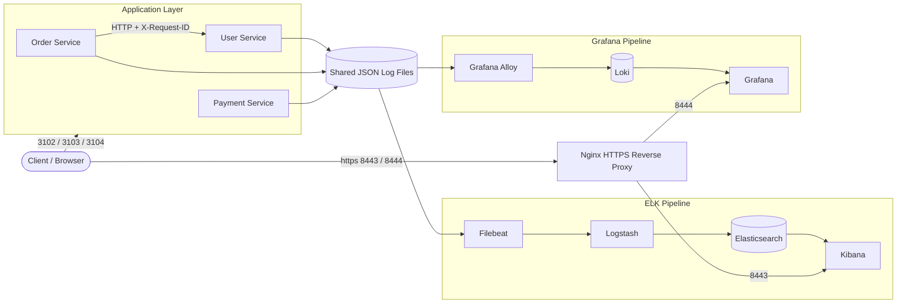
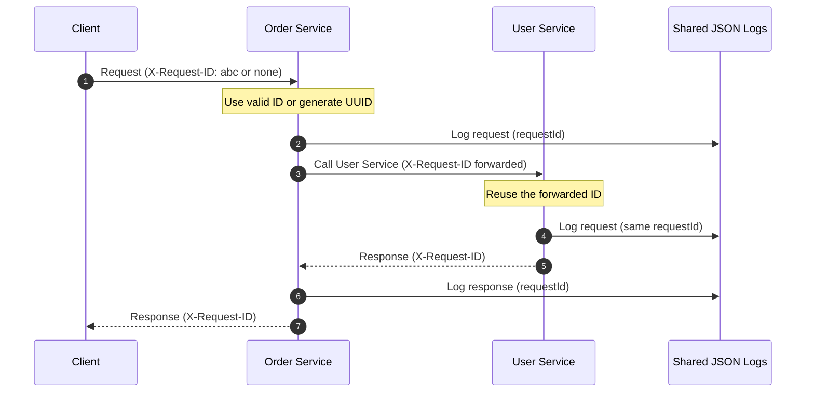
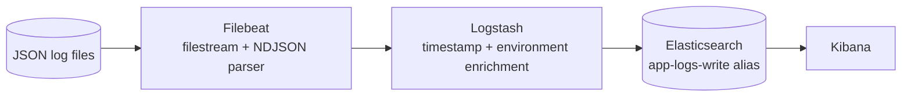
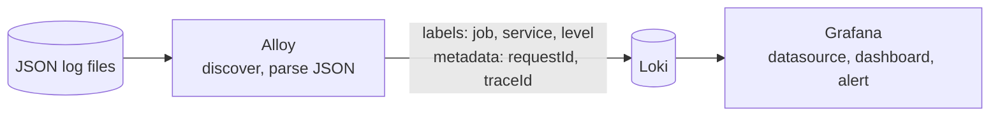

# Architecture

This document describes the architecture of the **Centralized Logging Pipeline**: three Node.js microservices whose structured logs are collected by two independent pipelines (ELK and Grafana Loki), fronted by an Nginx HTTPS reverse proxy and orchestrated with Docker Compose.

## Table of Contents

1. [Overview](#1-overview)
2. [High-Level Architecture](#2-high-level-architecture)
3. [Application Layer](#3-application-layer)
4. [Structured Logging and Request Correlation](#4-structured-logging-and-request-correlation)
5. [ELK Logging Pipeline](#5-elk-logging-pipeline)
6. [Grafana Logging Pipeline](#6-grafana-logging-pipeline)
7. [Security and HTTPS](#7-security-and-https)
8. [Storage and Retention](#8-storage-and-retention)
9. [Network and Port Mapping](#9-network-and-port-mapping)
10. [Integration Testing](#10-integration-testing)
11. [Important Configuration Files](#11-important-configuration-files)

---

## 1. Overview

The system demonstrates centralized logging for a small microservice application:

- **User Service**, **Order Service**, and **Payment Service** write structured JSON logs with Pino and pino-http.
- Every request carries an `X-Request-ID`, so events from different services can be tied together.
- Two independent pipelines read the same shared JSON log files:
  - **ELK:** Filebeat → Logstash → Elasticsearch → Kibana
  - **Grafana:** Grafana Alloy → Loki → Grafana
- **Nginx** provides HTTPS reverse-proxy access to Kibana and Grafana.
- **Docker Compose** manages the complete infrastructure.

Because both pipelines consume the same files, they are fully independent. Either stack can be stopped or replaced without affecting the other or the application.

---

## 2. High-Level Architecture



### Component summary

| Layer | Component | Responsibility |
|---|---|---|
| Application | User, Order, Payment Services | Serve requests and write structured JSON logs |
| Collection (ELK) | Filebeat | Tails JSON log files and forwards events to Logstash |
| Processing (ELK) | Logstash | Timestamp processing and environment enrichment |
| Storage (ELK) | Elasticsearch | Indexes logs through the `app-logs-write` alias |
| UI (ELK) | Kibana | Search and investigation |
| Collection (Grafana) | Grafana Alloy | Reads the same log files, extracts fields, assigns labels and structured metadata |
| Storage (Grafana) | Loki | Stores log streams indexed by labels |
| UI (Grafana) | Grafana | Datasource, dashboard, and alert rule |
| Edge | Nginx | TLS termination and reverse proxy for Kibana and Grafana |
| Orchestration | Docker Compose | Defines and runs all services |

---

## 3. Application Layer

### Services

| Service | Host Port | Responsibility |
|---|---|---|
| User Service | `3102` | Provides user listing and user lookup by ID |
| Order Service | `3103` | Creates and retrieves orders; validates users through User Service |
| Payment Service | `3104` | Provides payment creation and payment listing endpoints |


### Health-check endpoints

Each service exposes a health-check endpoint, used by the integration test and container health checks.

| Service | Health endpoint |
|---|---|
| User Service | `http://localhost:3102/health` |
| Order Service | `http://localhost:3103/health` |
| Payment Service | `http://localhost:3104/health` |


### Service-to-service communication

The Order Service calls the User Service over HTTP and forwards the current request ID in the `X-Request-ID` header, as described in [Section 4](#4-structured-logging-and-request-correlation).

---

## 4. Structured Logging and Request Correlation

### Structured JSON logging

Each service uses **Pino** for logging and **pino-http** for request and response logging. Every log line is a single JSON object written to a shared log file, which makes it machine-parseable with no regex-based parsing. Both pipelines read these same files.

Typical fields include the log level, timestamp, service identifier, request ID, and trace ID where applicable.

The application log records include fields such as `time`, `level`, `service`, `requestId`, and `traceId`. Request and response serializers also record HTTP method, URL path, and response status.

### Request ID handling

1. **Incoming ID:** if a request carries a valid `X-Request-ID`, the service uses it.
2. **Generation:** if the header is missing or invalid, the service generates a UUID.
3. **Response:** the ID is returned to the client in the `X-Request-ID` response header.
4. **Logging:** the ID is attached to every log line for that request.
5. **Propagation:** the Order Service forwards the ID to the User Service on outbound calls.

### Trace ID

Log events carry a `traceId` field for correlation. Currently, its value mirrors `requestId`; it is not an independently generated OpenTelemetry trace ID and does not represent distributed tracing. In the Grafana pipeline, both `requestId` and `traceId` are stored as Loki **structured metadata**, not as labels. A future tracing integration can populate this field with a real trace ID.

### Correlation sequence



### Investigating one request in both backends

Take the `X-Request-ID` from the response header, then search for it in each backend.

| Backend | Where | What you see |
|---|---|---|
| Elasticsearch | Kibana (`https://localhost:8443`), searching the `app-logs-*` data on the request ID field | Order and User Service events for that request |
| Loki | Grafana (`https://localhost:8444`), filtering on structured metadata for `requestId` | The same events from the Loki side |

Because the ID is propagated, one search returns events from multiple services, and the same ID works in both stacks.

---

## 5. ELK Logging Pipeline



### Filebeat

Filebeat reads the application log files with the **`filestream` input** and the **NDJSON parser**, so each line is decoded as one JSON event. It then forwards events to Logstash.

### Logstash

Logstash performs:

- **Timestamp processing:** sets the event timestamp from the application's log timestamp.
- **Environment enrichment:** adds environment information to each event.

Logstash adds the field `environment` with the value `development` to each processed event.

### Elasticsearch

Logstash writes through the **`app-logs-write` alias**. The pieces that make this work:

| Object | Name | Role |
|---|---|---|
| Write alias | `app-logs-write` | Stable write target |
| Index pattern | `app-logs-*` | Matches the rolled-over indices |
| Index template | `app-logs-template` | Applies settings and mappings to new indices |
| ILM policy | `application-logs-policy` | Rolls over after 7 days or 5 GB |

Elasticsearch is reachable only inside the Docker network and has no host port.

### Kibana

Kibana is the search and investigation interface. Using a data view over `app-logs-*`, you can filter by service, level, time range, or request ID. It is accessed through Nginx at `https://localhost:8443`.

---

## 6. Grafana Logging Pipeline



### Grafana Alloy

Alloy reads the same JSON log files, extracts fields from each JSON line, and builds the label set before pushing to Loki.

### Labels versus structured metadata

| Kind | Fields | Reason |
|---|---|---|
| **Loki labels** | `job`, `service`, `level` | Low cardinality; used to select streams |
| **Structured metadata** | `requestId`, `traceId` | High cardinality; attached to entries without creating streams |

Request IDs are unique per request. The current `traceId` field mirrors the request ID. Using these values as labels would create a very large number of streams and hurt Loki performance, so they are stored as structured metadata. They remain filterable at query time.

### Loki

Loki stores log streams indexed by labels and the log content separately. Queries select streams by label, then filter or aggregate over the matching lines with LogQL. Loki is published on host port `3101`.

### Grafana

- **Datasource:** Loki, provisioned for Grafana.
- **Dashboard:** *Centralized Application Logs*.
- **Alert rule:** *ApplicationErrorLogs*, which evaluates:

```logql
sum(count_over_time({job="application", level="50"}[5m]))
```

The alert fires when the five-minute error-log count is greater than zero for one minute, with warning severity.

The dashboard uses the Loki datasource (UID `eg4gv78cjmdc0e`) and has UID `application-logs`. The `ApplicationErrorLogs` alert rule was verified in the running Grafana configuration; it is not present in the repository files inspected here.

---

## 7. Security and HTTPS

### Nginx reverse proxy

Nginx terminates TLS and proxies to Kibana and Grafana inside the Docker network.

| Public URL | Proxied to |
|---|---|
| `https://localhost:8443` | Kibana |
| `https://localhost:8444` | Grafana |

### Self-signed certificate

The local certificate is generated with OpenSSL and stored in `security/certs/` as `localhost.crt` and `localhost.key`. The private key uses `600` permissions and is excluded from Git. Browsers warn about the certificate because it is self-signed.

### Why direct Kibana and Grafana ports are not exposed

Kibana's container port `5601` and Grafana's container port `3000` are not published directly on the host. Access to both interfaces is provided through Nginx over HTTPS. The Order Service uses container port `3002`, which is a separate service port. The integration test verifies that the direct Kibana and Grafana ports are not exposed.

### Log data protection

| Control | Behavior |
|---|---|
| **Pino redaction** | Configured sensitive fields are redacted before logs are written |
| **Query-string removal** | Query strings are stripped from logged request URLs |
| **Limitation** | Redaction is field-based. Arbitrary free-form message text is **not** automatically sanitized |

### Local-only binding

Published ports bind to `127.0.0.1`, so services are reachable only from the local machine. Secrets are kept in `.env`, which must not be committed.

---

## 8. Storage and Retention

### Named volumes

| Volume | Used by |
|---|---|
| `elasticsearch_data` | Elasticsearch indices |
| `loki_data` | Loki log data |
| `grafana_data` | Grafana state |
| `alloy_data` | Alloy state |

The Compose configuration defines these four named volumes. Filebeat and Logstash do not have dedicated named data volumes in the inspected Compose configuration.

The shared application log directory is a host-mounted path used by the services, Filebeat, and Alloy.

### Elasticsearch lifecycle

`application-logs-policy` rolls indices over after **7 days or 5 GB**. **No delete phase is configured**, so Elasticsearch does not delete old indices automatically and disk usage grows until they are removed manually.

### Loki retention

The current Loki configuration does not define an explicit retention period. Do not assume automatic log deletion or a specific retention duration.

### Data safety

`docker compose down` keeps volumes. **`docker compose down -v` permanently deletes them.**

---

## 9. Network and Port Mapping

| Component | Host Port | Access |
|---|---|---|
| User Service | `3102` | `http://localhost:3102` |
| Order Service | `3103` | `http://localhost:3103` |
| Payment Service | `3104` | `http://localhost:3104` |
| Loki | `3101` | `http://localhost:3101` |
| Kibana (via Nginx) | `8443` | `https://localhost:8443` |
| Grafana (via Nginx) | `8444` | `https://localhost:8444` |
| Elasticsearch | none | Internal to Docker network |
| Kibana container port (`5601`) | none | Not published to host; accessed through Nginx HTTPS |
| Grafana container port (`3000`) | none | Not published to host; accessed through Nginx HTTPS |

All published ports bind to `127.0.0.1`.

---

## 10. Integration Testing

The end-to-end test is `tests/integration.sh`. Run it from the repository root:

```bash
./tests/integration.sh
```

| Check | What it validates |
|---|---|
| Service health | All three services respond on their health endpoints |
| Application endpoints | Core service endpoints return expected responses |
| Order creation | An order can be created through the Order Service |
| Request ID propagation | The request ID appears in the response and is forwarded to the User Service |
| Elasticsearch correlation | Logs for the request ID are found in Elasticsearch |
| Loki correlation | Logs for the request ID are found in Loki |
| PII and query-string protection | Sensitive fields are redacted and query strings are absent from logs |
| HTTPS proxy access | Kibana and Grafana are reachable through Nginx over HTTPS |
| Direct port exposure | Direct Kibana and Grafana host ports are not reachable |

The latest recorded run was 16 passed, 0 failed. This is a point-in-time result, not a guarantee for future runs.

---

## 11. Important Configuration Files

| Area | File | Purpose |
|---|---|---|
| Orchestration | `docker-compose.yml` | Defines application services, infrastructure, networks, ports, and volumes |
| Environment | `.env.example` | Documents environment variables required by the stack |
| Environment | `.env` | Local environment configuration; must never be committed |
| User Service | `services/user-service/src/index.js` | User API endpoints and structured logging |
| Order Service | `services/order-service/src/index.js` | Order API, user-service integration, and request ID propagation |
| Payment Service | `services/payment-service/src/index.js` | Payment API endpoints and structured logging |
| Application dependencies | `services/*-service/package.json` | Service dependencies and npm scripts |
| Filebeat | `elk/filebeat/filebeat.yml` | Reads application JSON logs and forwards events to Logstash |
| Logstash | `elk/logstash/pipeline/logstash.conf` | Processes events and forwards them to Elasticsearch |
| Elasticsearch template | `elk/elasticsearch/app-logs-template.json` | Defines application log index mappings and lifecycle settings |
| Alloy | `grafana-stack/alloy/config.alloy` | Reads application logs, extracts fields, and sends logs to Loki |
| Loki | `grafana-stack/loki/loki-config.yml` | Loki storage, schema, and ingestion configuration |
| Grafana dashboard | `grafana-stack/grafana/dashboards/application-logs.json` | Centralized application logs dashboard |
| Nginx | `security/nginx/default.conf` | HTTPS reverse proxy configuration for Kibana and Grafana |
| TLS certificate | `security/certs/localhost.crt` | Local HTTPS certificate; not a production certificate |
| Integration tests | `tests/integration.sh` | End-to-end validation of services, correlation, logging, and HTTPS access |
| Architecture | `docs/architecture.md` | Project architecture and technical documentation |

Private keys, credentials, and local environment secrets must not be committed to version control.
